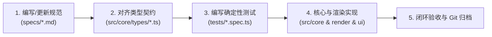

# SPEC-00：总体愿景、设计决策与 Spec-Driven 开发规范

- **状态：** `APPROVED (已确认)`
- **版本：** `v1.0.0`
- **最后更新：** `2026-11-05`

---

## 1. 核心产品定位

本项目旨在构建一款面向 **PC / Mac 桌面端（高刷 Web 端 + Tauri 原生桌面端）** 的历史大战略游戏：
* **核心骨架（《三国志9 PK》）：** 继承“全中华一张连续大地图（一枚マップ）”、“十日一旬（战略阶段下令 + 进行阶段 10 天自动推演）”以及“5 将一队、前中后三列阵型、9 系兵法自动触发与 2～5 人连锁（`联动`）”的宏观沙盘博弈体验。
* **战略深度扩展（《三国志11》+《维多利亚3 / 欧陆风云5 / 十字军之王3》）：**
  1. **大地图领地内政与军备生产（San11）：** 在城市领地内建设 `Lv1 → Lv3` 全被动产出的经济与军工建筑，阵型与城池武库军备绑定。
  2. **真实人口阶层与流民迁徙（EU5 / Vic3）：** 自耕农、世家部曲、工匠、流民四大动态阶层，征兵消耗自耕农并影响建筑劳动力开工率，战火驱动流民跨城迁徙。
  3. **政令控制度与世家门阀博弈（EU5）：** 城市控制度（0–100%）随距首都交通耗时衰减，地方世家门阀兼并隐户、截留赋税，君主可通过 `屯田制 / 唯才是举 / 九品官人` 等国策调节集权与门阀支持。
  4. **水陆自动军需漕运网（Vic3）：** 后方基地盈余物资按水陆漕运力自动流向前线重点军镇，彻底免除后期机械式手动输送。
  5. **人物关系账本、性格特质、把柄（Hooks）与战场自主性格反应（CK3）：** 宗族、血仇、把柄与武将性格直接干预 10 天进行阶段的战场行为（死敌血战、贪功追击、谨慎重整、临阵倒戈）。

---

## 2. 已锁定核心设计决策表

| 决策维度 | 规范定义 |
| :--- | :--- |
| **目标平台** | **仅限 PC / Mac 桌面端**（放弃手机移动端，全面拥抱桌面高密度宽屏交互与多线程算力）。 |
| **前端与桌面技术栈** | **TypeScript / ES2022 + HTML5 2D High-DPI Canvas（平面战术沙盘渲染）+ React 19 + Tailwind CSS**，支持 Tauri 桌面端原生打包。 |
| **多线程与性能架构** | **主线程（UI + 2D Canvas 渲染）与模拟线程彻底分离**；采用流场寻路（Flow Field）与战略阶段后台 AI 预计算（0 毫秒等待进入进行阶段）。 |
| **沙盘视角与美术演进** | **2D 平面战略兵棋/古风舆图风格（Flat 2D Wargame & Parchment Map）** + **五大战略地图透镜（`F1`～`F5`）**，清晰呈现山川关隘、州郡疆域、城外内政用地、ZOC 控制网、行军箭头与兵牌。 |
| **桌面交互范式** | **16:9 / 21:9 宽屏高密度布局**，配备 P 社风格 **可锁定嵌套悬浮提示框（Nested Tooltips）**、键鼠快捷键、右键上下文菜单与虚拟化多维排序大表。 |
| **玩家模式** | **100% 纯客户端离线优先：单人模式 + 本地多君主同屏热座模式（Hotseat 1～8 名玩家）**。 |
| **语言与术语** | **简体中文为主**，架构内置中英双语 i18n，严格保留正统三国与大战略术语。 |
| **敏捷交付策略** | **M1 优先交付《中原逐鹿（虎牢—官渡战区）》可玩垂直切片 Demo**（12 都市 + 6 关港 + 5 势力 + 80 名将），跑通完整可玩闭环后再横向扩展至全中华 50+ 都市。 |

---

## 3. Spec-Driven Development (SDD) 工程研发流程

1. **单一事实来源（Single Source of Truth）：** `specs/` 目录是所有公式、规则、状态机与数据结构的唯一权威定义。
2. **纯函数与确定性模拟：** 模拟核心（`src/core/`）必须使用可复现的伪随机数生成器（Seeded PRNG，如 `Mulberry32` 或 `XorShift128+`），给定相同的 `GameState` 与 `PlayerOrders` 必须产出 100% 一致的 10 天推演结果。
3. **里程碑增量提交：** 每个子模块或里程碑完成后，必须通过类型检查、单元测试与可玩性验收，并关联对应的 Spec 编号进行 Git 归档。
