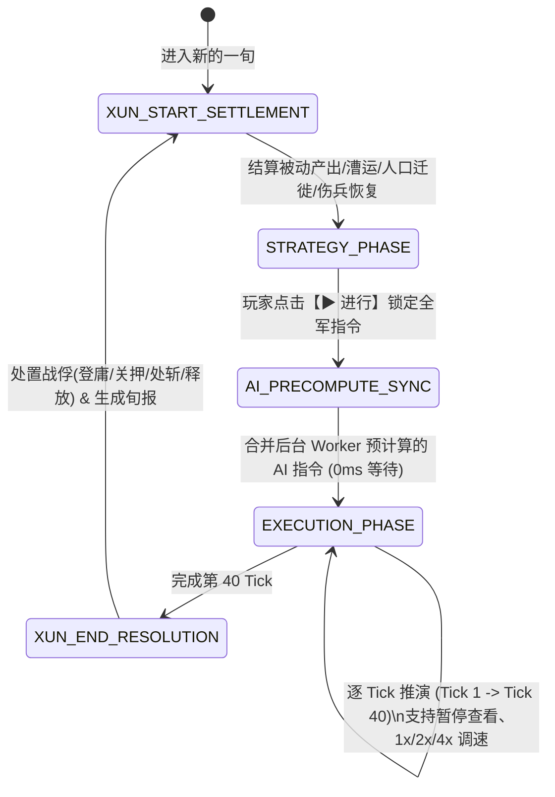

# SPEC-01：十日一“旬”核心循环、大地图网格与战斗兵法规范

- **状态：** `APPROVED (已确认)`
- **版本：** `v1.0.0`
- **关联模块：** `src/core/sim/`, `src/core/map/`, `src/core/combat/`

---

## 1. 时间单位与十日一“旬”双阶段循环

### 1.1 时间刻度定义
* **最小模拟步长（Tick）：** `1 天 = 4 Ticks`（分别对应 `晨、午、暮、夜` 4 个子时间片），`1 旬 = 10 天 = 40 Ticks`。
* **日历结构：**
  * 每月固定分为三旬：`上旬`（1日～10日）、`中旬`（11日～20日）、`下旬`（21日～30日）。
  * 每年 12 个月，共计 **36 旬 / 年**。
  * **四季划分与气候：**
    * `春季`（1～3月）：春耕播种期，北方冰雪消融。
    * `夏季`（4～6月）：行军耗粮正常，南方湿地瘴气加重。
    * `秋季`（7～9月）：**7月上旬（`7月上旬`）固定为年度兵粮大收成结算日**。
    * `冬季`（10～12月）：北方（秦岭—淮河以北）进入积雪期，陆地行军速度 $-15\%$。
  * **季度税收结算日：** 每年 `1月上旬`、`4月上旬`、`7月上旬`、`10月上旬` 触发季度大税收与世家门阀季度结算。

### 1.2 双阶段状态机

---

## 2. 大地图网格、地形矩阵与据点占地规范

### 2.1 分块方格网（Chunked Square Grid）
* 地图由 $W \times H$ 个正方格组成，按 `64×64` 划分为独立地形分块（Chunk）。
* 移动支持 **8 方向**（正北、东北、正东、东南、正南、西南、正西、西北）：
  * 正交 4 方向基础距离系数为 $1.0$；
  * 对角线 4 方向基础距离系数为 $\sqrt{2} \approx 1.414$。

### 2.2 可配置据点占地与控制区（ZOC）
* **占地格子（Footprint）：**
  * 大都市（`CITY`）：可配置为 `2×2` 或 `1×1`；
  * 关隘（`PASS`）、港口（`PORT`）、县城（`COUNTY`）、野外军事设施（`FACILITY`）：默认 `1×1`。
* **控制区（Zone of Control, ZOC）：**
  * 城池、关隘、港口及野外 `阵/砦/城塞` 在周围 1～2 格形成敌对 ZOC；野外敌方作战部队在周围 1 格形成敌对 ZOC。
  * 当部队进入敌对 ZOC 格时，本 Tick 行军速度强制降为最低（每日前进不超过 1 格），且不能直接穿过敌方据点本体格（除非主将拥有 `飞将` 特技可无视陆地部队 ZOC）。

### 2.3 地形修正参数表

| 地形 ID | 中文名称 | 步兵代价 | 骑兵代价 | 器械代价 | 防御修正 | 特殊地形规则 |
| :--- | :--- | :---: | :---: | :---: | :---: | :--- |
| `ROAD` | `官道` | 0.7 | 0.6 | 0.8 | 1.00 | 陆路军需漕运主干道，损耗最低 |
| `PLAIN` | `平原` | 1.0 | 0.8 | 1.2 | 1.00 | 骑兵系（`锋矢/锥行`）兵法触发率 $\times 1.15$ |
| `FOREST` | `森林` | 1.5 | 2.2 | 2.5 | 1.15 | 远程兵法伤害 $-25\%$；火攻与伏兵伤害 $+25\%$ |
| `MOUNTAIN` | `山地/高地` | 2.2 | 3.5 | 禁行 | 1.30 | `长蛇` 阵型免除山地移动惩罚；可触发 `岩罠` |
| `MARSH` | `湿地/毒泉` | 2.0 | 3.0 | 3.5 | 0.90 | 无 `踏破` 特技时，毒泉每日造成 $1.5\%$ 非战斗减员 |
| `FORD` | `浅滩` | 1.8 | 2.5 | 2.5 | 0.85 | 水陆交界渡口，可触发 `水罠` |
| `WATER` | `川/海` | 水军 | 水军 | 水军 | 1.00 | 自动切换为水军阵型（默认 `走舸`，配船则为 `蒙冲/楼船/斗舰`） |
| `CLIFF` | `栈道/绝壁` | 2.5 | 4.0 | 禁行 | 1.10 | 仅单格通行要道，极易被 `落穴/岩罠` 阻断 |

---

## 3. 部队编成、阵型三列站位与军备绑定规范

### 3.1 五将编成与主将顺位
* 每支部队包含 **1～5 名武将**，带兵上限由 **主将（`Commander`）** 的爵位或武官官职决定（无官职基础上限 $10,000$ 兵，大将军/君主可达 $50,000\text{～}60,000$ 兵）。
* **主将自动判定规则：**
  1. 势力君主本人；
  2. 武官官职（`MilitaryOffice`）品级最高者；
  3. 若品级相同或均无武官官职，则取 **统率（`LDR`）** 最高者。

### 3.2 前 / 中 / 后三列站位机制（`前列 / 中列 / 后列`）
* 每种阵型固定 5 个槽位在 `FRONT (前列)`、`MIDDLE (中列)`、`REAR (后列)` 的分布：
  * **前列（`FRONT`）：** 近战兵法（`步兵/骑兵/水军强袭`）触发率 $\times 1.15$；承受正常单挑、战死、负伤与战败被俘判定。
  * **中列（`MIDDLE`）：** 全系兵法触发率 $\times 1.05$；战败被俘概率降低 $25\%$。
  * **后列（`REAR`）：** 远程与智力兵法（`弩兵/弓骑/攻城/智略/谋略/策略`）触发率 $\times 1.20$；免受近战单挑与近战兵法狙击，但会被敌方 **弓骑系（`骑射/走射/飞射`）** 与 **水军远程（`矢雨/矢岚`）** 专门点名狙杀！

### 3.3 阵型与武库军备绑定完整参数表

| 阵型 ID | 中文名 | 每 1,000 兵所需武库军备 | 三列槽位 (前-中-后) | 攻击 | 防御 | 速度 | 抗谋略 | 适性兵法倍率与特性 |
| :--- | :--- | :--- | :---: | :---: | :---: | :---: | :---: | :--- |
| `LONG_SNAKE` | `长蛇` | 无（民兵/输送/急行军） | 1-2-2 | 80 | 80 | **130** | 1.0x | 山地不减速；战斗兵法触发率 $0.7\times$ |
| `FISH_SCALE` | `鱼鳞` | `1,000` 步兵军备 | 3-1-1 | 115 | 110 | 95 | 1.0x | `步兵` $1.6\times$；发动步兵兵法概率救回己方俘虏 |
| `CRANE_WING` | `鹤翼` | `1,000` 步兵军备 | 2-2-1 | 105 | 120 | 90 | 1.1x | `步兵` $1.4\times$、`智略` $1.3\times$ |
| `SQUARE` | `方圆` | `1,000` 步兵军备 | 2-1-2 | 75 | **150** | 75 | **2.0x** | `策略` $1.4\times$；敌方 `混乱/心攻/幻术` 成功率减半 |
| `YOKE` | `衡轭` | `1,000` 步兵军备 | 2-1-2 | 100 | 125 | 95 | 1.3x | `步兵` $1.2\times$、`谋略` $1.3\times$ |
| `ARROWHEAD` | `锋矢` | `1,000` 战马 | 1-2-2 | **145** | 85 | 120 | 0.8x | `骑兵` $1.8\times$；平原野战破阵核心 |
| `AWL` | `锥行` | `1,000` 战马 (+可选 `弓弩`) | 1-2-2 | 120 | 80 | **145** | 0.8x | `骑兵` $1.4\times$、`弓骑` $2.0\times$；**全队联动概率 $1.5\times$** |
| `WILD_GEESE` | `雁行` | `1,000` 弓弩 | 2-2-1 | 110 | 95 | 85 | 1.0x | `弩兵` $2.0\times$；具备 2 格远程普通射击能力 |
| `BASKET` | `箕形` | `1,000` 弓弩 (+可选 `战马`) | 2-1-2 | 115 | 100 | 95 | 1.0x | `弩兵` $2.0\times$、`弓骑` $2.0\times$ |
| `RAM` | `冲车` | `1` 具冲车器械 | 3-2-0 | 60/250城 | 130 | 55 | 1.0x | `破城` $2.5\times$；对据点耐久造成巨额破坏 |
| `SIEGE_TOWER` | `井阑` | `1` 具井阑 + `1,000` 弓弩 | 0-3-2 | 125(守军) | 90 | 60 | 0.9x | `射岚` $2.0\times$、`弩兵` $2.0\times$；2格射程杀伤城内守军 |
| `CATAPULT` | `投石` | `1` 具投石机器械 | 0-2-3 | 180(双伤) | 70 | 50 | 0.9x | `投石` $2.5\times$；2～3格远程同时轰击城防与范围内敌军 |
| `NAVAL_LIGHT` | `走舸` | 无（入水默认轻舟） | 2-2-1 | 80 | 70 | 105 | 1.0x | `水军` $0.8\times$ |
| `NAVAL_RAM` | `蒙冲` | `1` 艘蒙冲战船 | 3-1-1 | 125 | 115 | **130** | 1.0x | `强袭/强攻` $1.8\times$ |
| `NAVAL_TOWER` | `楼船` | `1` 艘楼船 + `1,000` 弓弩 | 1-2-2 | 130 | 125 | 100 | 1.1x | `矢雨/矢岚` $1.8\times$；水上 2 格远程射击 |
| `NAVAL_FORTRESS`| `斗舰` | `1` 艘斗舰 + `1,000` 弓弩 | 2-2-1 | **155** | **150** | 110 | 1.3x | 全系 `水军` 兵法 $2.0\times$；水上霸主 |

---

## 4. 九大系 38 种兵法与战斗数学公式规范

### 4.1 兵法谱系与熟练度晋升表
武将每次在战场上触发某系兵法，该系熟练度 $+12\text{～}+25$（同队旁观队友 $+4$）。当熟练度达到阈值且有导师或顿悟时可习得高阶兵法：

| 系别 | 初阶 (熟练 0) | 中阶 (熟练 100) | 奥义 (熟练 300) | 特殊/衍生兵法 | 主属性依赖 |
| :--- | :--- | :--- | :--- | :--- | :--- |
| **1. 步兵系** | `奋战` (威力 100) | `奋斗` (威力 145) | `奋迅` (威力 200) | 触发时概率救回本方被俘武将 | `武力` |
| **2. 骑兵系** | `突破` (威力 110) | `突进` (威力 160) | `突击` (威力 225) | 配合 `疾驰` 附加混乱 | `武力` |
| **3. 弓骑系** | `骑射` (威力 95) | `走射` (威力 135) | `飞射` (威力 185) | 精准狙击敌方中/后列武将使其负伤 | `武力` |
| **4. 弩兵系** | `齐射` (威力 95) | `连射` (威力 140) | `连弩` (威力 195) | 2～3 格远程火力压制 | `武力` |
| **5. 水军系** | `矢雨` / `强袭` | `矢岚` / `强攻` | — | 水上远程狙击 / 接舷撞击救俘虏 | `武力` |
| **6. 攻城系** | `破城` (毁墙 220) | `射岚` (杀兵 180) | `投石` (双伤+AoE) | 专用于摧毁据点与守军 | `统率 + 智力` |
| **7. 智略系** | `扰乱` (降防 35%) | `伪退` (强制引诱) | `攻心` (吸兵 30%) | 将敌方战损直接转化为己方兵力 | `智力` |
| **8. 谋略系** | `混乱` (眩晕 3-6天)| `陷阱` (穴/火/水/岩)| `心攻` / `幻术` | 控制敌军行动或造成范围法术轰炸 | `智力` |
| **9. 策略系** | `骂声` (敌士气-15) | `鼓舞` (己士气+20)| `治疗` / `妖术` | `治疗` 直接将本队 1,500～3,000 伤兵转为战力 | `智力` |

### 4.2 核心战斗数值公式

1. **部队有效统率与基础攻防：**
   $$\text{EffectiveLDR} = \text{Commander}_{\text{LDR}} + 0.15 \times \max_{i \in \text{Deputies}}(\text{Deputy}_{i,\text{LDR}} - 60, 0)$$
   $$\text{UnitAtk} = \text{EffectiveLDR} \times \frac{\text{Formation}_{\text{Atk}}}{100} \times \left(0.5 + 0.5 \times \frac{\text{Morale}}{100}\right) \times \sqrt{\frac{\text{Troops}}{1000}}$$
   $$\text{UnitDef} = \text{EffectiveLDR} \times \frac{\text{Formation}_{\text{Def}}}{100} \times \text{TerrainDefMod}$$

2. **普通交战伤害（每 Tick）：**
   $$\Delta \text{Troops}_{\text{normal}} = \text{round}\left(18 \times \frac{\text{Attacker}_{\text{UnitAtk}}^{1.25}}{\max(20, \text{Defender}_{\text{UnitDef}})} \times \text{Random}(0.92, 1.08)\right)$$

3. **兵法触发概率（每交战日 / 每 4 Ticks 判定一次）：**
   $$P(\text{Trigger}_i) = 0.12 \times \text{FormationAffinity} \times \text{RowMod}_i \times \left(1 + \frac{\text{PrimaryStat}_i - 70}{100}\right) \times \left(1 + \frac{\text{Proficiency}_i}{1000}\right) \times \left(\frac{\text{Morale}}{100}\right) \times \text{PersonalityMod}_i$$

4. **兵法连锁（`联动`：2 联动～5 联动）触发概率与伤害倍增：**
   当武将 $A$ 触发兵法后，同队习得同系兵法的武将 $B$ 加入联动的概率为：
   $$P(\text{Chain}_{A \to B}) = 0.25 \times \text{FormationChainMod} \times \text{BondMultiplier}_{A,B}$$
   * **羁绊系数 $\text{BondMultiplier}_{A,B}$：**
     * 仇敌（`NEMESIS`）：$0$（死敌绝不配合联动）
     * 义兄弟 / 夫妻（`SWORN_SIBLING / SPOUSE`）：$2.2\times$
     * 血缘宗亲（`BLOOD_KIN`）：$1.8\times$
     * 同门阀世家（`SAME_CLAN`）：$1.35\times$
     * 隐藏相性环距离 $\Delta = \min(|A_{\text{compat}} - B_{\text{compat}}|, 150 - |A_{\text{compat}} - B_{\text{compat}}|)$：
       $$\text{CompatMod} = \max\left(0.4,\; 1.5 - \frac{\Delta}{25}\right)$$
   * **联动总伤害：**
     $$\text{ChainDamage} = \left(\sum_{k=1}^{N_{\text{chain}}} \text{BaseTacticDmg}_k\right) \times \text{ChainMultiplier}(N_{\text{chain}})$$
     其中 $\text{ChainMultiplier} = \{1\text{人}: 1.0,\; 2\text{联动}: 1.35,\; 3\text{联动}: 1.75,\; 4\text{联动}: 2.25,\; 5\text{联动}: 3.0\}$。

5. **伤兵转化与士气归零溃灭：**
   * 每次战斗损失兵力 $\Delta L$ 中，有 $35\%$ 转化为部队随军 **伤兵（`wounded`）**（火攻/投石伤害仅转化 $15\%$）。
   * **士气归零溃灭铁律：** 部队离开己方领地每 2 天 $-1$ 士气；断粮（`food == 0`）每天 $-5$ 士气并逃亡 $3\%$ 兵力；一旦 `morale <= 0`，无论部队剩余多少兵力，**立即全军溃灭解散**，随军武将触发高概率被俘判定！
